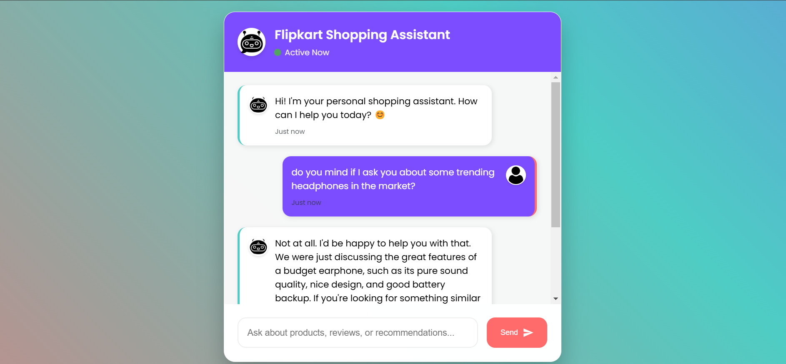
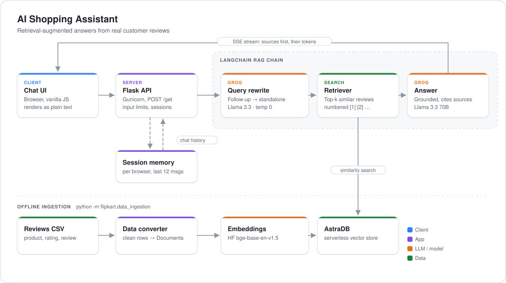
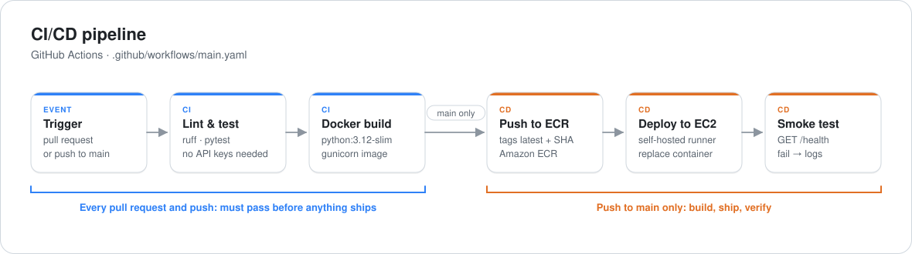

# 🛍️ AI Shopping Assistant

[](https://github.com/yunus5603/AI-Shopping-Assistant/actions/workflows/main.yaml)
[](https://www.python.org/)
[](https://python.langchain.com/)
[](https://groq.com/)
[](https://www.datastax.com/products/datastax-astra)
[](https://aws.amazon.com/)
[](LICENSE)

A retrieval-augmented (RAG) shopping assistant that answers product questions from **real Flipkart customer reviews**. It remembers the conversation, streams answers token by token, and shows the exact reviews each answer is based on, with numbered citations.

It also covers the full delivery loop: tests and lint gate every change, and pushes to `main` build a Docker image, push it to Amazon ECR and roll it out to EC2 with a health-checked deploy.



## Highlights

- **Grounded answers with citations.** Retrieved reviews are numbered `[1]`, `[2]`… in the prompt, the model cites them, and the UI lists them under each answer. The prompt tells the model to say when the reviews don't cover a question rather than invent specs or prices.
- **Conversation memory.** Follow-ups like *"how is its battery?"* are rewritten into a standalone search query using the chat history before retrieval. Memory is per browser session (signed cookie), trimmed to recent turns and bounded across sessions.
- **True streaming.** Tokens are streamed from the LLM to the browser over Server-Sent Events while they are generated. Sources arrive first, then the answer.
- **Measured, not guessed.** An evaluation harness scores retrieval hit rate, faithfulness and relevance (LLM judge), citation validity and out-of-scope refusals against a golden question set.
- **Tested without API keys.** 30+ pytest tests run the real LangChain pipeline with fake LLMs and retrievers, so CI needs no secrets.
- **Production basics.** Gunicorn, health endpoint, non-root container, input limits, no internal errors leaked to users, and model output rendered as text only (no HTML injection).

## Architecture

<picture>
  <source media="(prefers-color-scheme: dark)" srcset="docs/diagrams/architecture-dark.svg">
  
</picture>

Each request is one pass through the chain. On follow-up turns the question is first rewritten into a standalone search query using the chat history; on the first turn that step is skipped. Retrieved reviews are numbered so the answer can cite them, and the browser receives the sources before the first token.

### CI/CD

<picture>
  <source media="(prefers-color-scheme: dark)" srcset="docs/diagrams/cicd-dark.svg">
  
</picture>

## Evaluation

`eval/golden_set.jsonl` holds in-scope questions (bass, battery, mic quality, comfort, complaints…) and out-of-scope ones (laptops, fridges, trivia) that the assistant should decline.

```bash
python -m eval.run_eval          # writes eval/results/latest.json and prints a table
```

| Metric | What it checks |
|---|---|
| Retrieval hit rate / precision @k | Do the top-k reviews actually mention what was asked about? |
| Faithfulness (LLM judge, 1–5) | Is every claim in the answer supported by the retrieved reviews? |
| Answer relevance (LLM judge, 1–5) | Does the answer address the question? |
| Citation rate / validity | Does the answer cite sources, and do the numbers point at real ones? |
| Out-of-scope refusal rate | Does it decline questions the reviews can't answer? |

<!-- Paste the table printed by `python -m eval.run_eval` here after a run. -->

## Design decisions and trade-offs

| Decision | Why | Trade-off |
|---|---|---|
| Reviews are the retrieval unit (one document per review) | Answers can cite a specific customer's words | Many near-duplicate reviews per product; aggregating per product would give broader coverage |
| Separate temperature-0 call to rewrite follow-ups | Retrieval sees "boAt Airdopes battery", not "how is its battery?" | One extra LLM call on follow-up turns (skipped on the first turn) |
| Groq-hosted Llama 3.3 70B | Very low latency, which matters for a streaming chat | Tied to one provider; the model is injectable, so swapping is a constructor argument |
| AstraDB serverless vectors | Managed, free tier, no infra to run | Network hop per query; FAISS/Chroma would be faster for a static dataset |
| In-memory session store, one Gunicorn worker | Simple and fast for a demo | Memory is lost on restart and doesn't scale across workers; Redis would fix both |
| Keyword-based retrieval check plus LLM judge | Cheap, transparent and runnable in minutes | Keyword relevance is coarse; RAGAS or human labels would be more precise |

## Quick start

**Requirements:** Python 3.10+, and free accounts for [Groq](https://console.groq.com/keys), [AstraDB](https://astra.datastax.com) and [Hugging Face](https://huggingface.co/settings/tokens).

```bash
git clone https://github.com/yunus5603/AI-Shopping-Assistant.git
cd AI-Shopping-Assistant
python -m venv .venv && source .venv/bin/activate
pip install -r requirements-dev.txt
cp .env.example .env            # fill in your keys
```

Put the review dataset at `data/flipkart_product_review.csv` (columns `product_title, rating, summary, review`), or point `PRODUCT_DATA_PATH` at it. Then load it into AstraDB once and start the app:

```bash
python -m flipkart.data_ingestion   # embed and store the reviews
python app.py                       # http://localhost:5000
```

### Docker

```bash
docker build -t shopping-assistant .
docker run --env-file .env -p 5000:5000 shopping-assistant
```

### Tests and lint

```bash
pytest                 # no API keys needed
ruff check . && ruff format --check .
```

## API

| Method | Path | Description |
|---|---|---|
| `GET` | `/` | Chat UI |
| `POST` | `/get` | Form field `msg` (max 1000 chars). Returns `text/event-stream` with `{"sources": [...]}`, then `{"token": "..."}` events, then `{"done": true}` |
| `POST` | `/reset` | Clears this browser's conversation memory |
| `GET` | `/health` | Liveness check used by Docker and the deploy smoke test |

## Project structure

```
├── app.py                        # Flask app factory, SSE endpoint, sessions
├── flipkart/
│   ├── data_converter.py         # CSV → cleaned LangChain Documents
│   ├── data_ingestion.py         # Embeddings + AstraDB vector store, ingestion CLI
│   └── retrieval_generation.py   # History-aware RAG chain, citations, session memory
├── eval/
│   ├── golden_set.jsonl          # Evaluation questions
│   ├── metrics.py                # Scoring helpers
│   └── run_eval.py               # Evaluation runner
├── tests/                        # pytest suite (fake LLM + retriever)
├── static/ , templates/          # Chat UI
├── Dockerfile
└── .github/workflows/main.yaml   # Lint/test → build → ECR → EC2
```

## Deployment (AWS)

Pushes to `main` deploy automatically once these repository secrets are set: `AWS_ACCESS_KEY_ID`, `AWS_SECRET_ACCESS_KEY`, `AWS_DEFAULT_REGION`, `ECR_REPOSITORY_NAME`, `AWS_ECR_LOGIN_URI`, `GROQ_API_KEY`, `ASTRA_DB_API_ENDPOINT`, `ASTRA_DB_APPLICATION_TOKEN`, `ASTRA_DB_KEYSPACE`, `HF_TOKEN` and `FLASK_SECRET_KEY`. The EC2 instance needs Docker and a [self-hosted GitHub Actions runner](https://docs.github.com/en/actions/hosting-your-own-runners).

## Roadmap

- [ ] Hybrid search (BM25 + vectors) and a reranker
- [ ] Per-product review aggregation (pros/cons summaries)
- [ ] Redis-backed session memory for multi-worker deploys
- [ ] Price and category filters through metadata
- [ ] Always-on hosted demo (Render or Hugging Face Spaces)

## Contributing

Contributions are welcome. See [CONTRIBUTING.md](CONTRIBUTING.md) to get set up, and look for issues labelled `good first issue`.

## License

[MIT](LICENSE) © Yunus Shaikh
